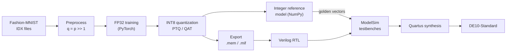
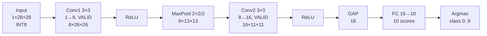
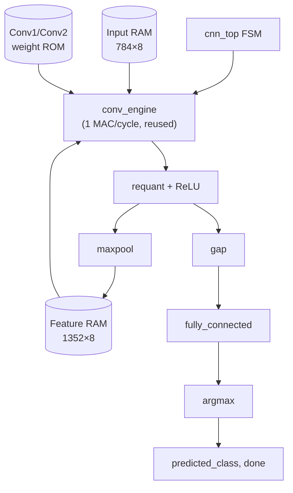

# Two-Layer CNN Image Classification Accelerator on Intel Cyclone V FPGA

An educational, end-to-end FPGA CNN inference project. A small two-layer CNN
classifies Fashion-MNIST, and the inference itself runs in Verilog RTL on a
**Terasic DE10-Standard** (Intel Cyclone V SoC: physical board device
`5CSXFC6D6F31C6N` and spec device `5CSEBA6U23I7` are both supported).
Python/PyTorch is used only for:

- dataset preparation
- training
- quantization
- weight export
- bit-exact software reference models

The ARM HPS is **not** used to run the network.

Long-term target: LSI Design Contest 2027.

> **Current status:** Milestones 1 (dataset) and 2 (PyTorch CNN & tensor shape
> verification) are complete. Waiting for approval to start Milestone 3 (FP32
> training). See the [milestone log](docs/development_plan.md).

---

## Contents

1. [Objectives](#1-objectives)
2. [Repository layout](#2-repository-layout)
3. [Environment setup](#3-environment-setup)
4. [Dataset](#4-dataset)
5. [CNN architecture](#5-cnn-architecture)
6. [Training](#6-training) (Milestone 3)
7. [Quantization](#7-quantization) (Milestone 4)
8. [Memory format](#8-memory-format) (Milestone 5)
9. [Integer reference model](#9-integer-reference-model) (Milestone 6)
10. [RTL architecture](#10-rtl-architecture) (Milestones 7–9)
11. [ModelSim simulation](#11-modelsim-simulation) (Milestones 8–9)
12. [Quartus synthesis](#12-quartus-synthesis) (Milestone 10)
13. [Hardware deployment](#13-hardware-deployment) (Milestone 10)
14. [Milestone status](#14-milestone-status)

---

## 1. Objectives

- Learn and document the complete FPGA CNN inference flow: data → training →
  INT8 quantization → memory export → bit-exact reference → RTL → simulation
  → synthesis → board.
- Keep a single arithmetic convention from Python to Verilog:
  - signed INT8 weights and activations
  - INT32 accumulators and biases
  - explicit requantization with documented rounding and saturation
- Prefer correctness, readability and reproducibility over early
  optimization: one sequential MAC engine, on-chip M10K memories, no DDR.



## 2. Repository layout

Directories marked *(planned)* are created at the milestone shown.

```text
fpga_midterm/
├── README.md                    this file
├── requirements.txt             Python deps (PyTorch installed separately)
├── .gitignore
├── docs/
│   ├── development_plan.md      milestones, decisions, status log
│   ├── preprocessing.md         dataset + input conversion spec        (M1)
│   ├── tensor_dimensions.md     every tensor shape, MACs, memory sizes (M1)
│   ├── quantization_spec.md     scales, shifts, rounding, saturation   (M4, planned)
│   ├── memory_map.md            .mem/.mif layouts and address maps     (M5, planned)
│   └── rtl_architecture.md      block diagrams, FSM, timing            (M7, planned)
├── sw/                          Python package, run as `python -m sw.<module>`
│   ├── config.py                paths + numeric conventions (single source of truth)
│   ├── data/                    download, IDX parser, preprocessing, split   (M1)
│   ├── model/                   PyTorch CNN + shape checks                   (M2)
│   ├── train/                   training / evaluation scripts                (M3, planned)
│   ├── quant/                   PTQ / QAT, integer parameter extraction      (M4, planned)
│   ├── export/                  .mem/.mif writers + read-back verification   (M5, planned)
│   ├── refmodel/                bit-exact integer inference + golden vectors (M6, planned)
│   └── tests/                   automated tests per milestone
├── data/
│   ├── raw/                     downloaded .gz files     (git-ignored)
│   ├── processed/               regenerated .npz files   (git-ignored)
│   └── splits/                  train/val indices        (tracked)
├── checkpoints/                 trained models           (M3, git-ignored)
├── mem/                         exported .mem / .mif     (M5, planned)
├── rtl/                         synthesizable Verilog-2001 (M7, planned)
├── sim/
│   ├── tb/                      testbenches              (M8, planned)
│   ├── do/                      ModelSim .do scripts     (M8, planned)
│   └── vectors/                 golden input/output vectors (M6, planned)
├── quartus/                     DE10-Standard project, .qsf, .sdc (M10, planned)
└── reports/
    ├── dataset/                 M1 statistics and figures
    ├── model/                   M2 shapes, parameter & MAC summary
    ├── training/                M3 (planned)
    ├── quantization/            M4 (planned)
    ├── simulation/              M8–M9 (planned)
    └── synthesis/               M10 (planned, kept separate from simulation)
```

## 3. Environment setup

```powershell
# from the repository root
python -m pip install -r requirements.txt       # numpy, matplotlib, pytest
```

PyTorch 2.11.0+cu128 is installed and verified on the NVIDIA GeForce RTX 5050
Laptop GPU (`sm_12.0`). To install on another machine:

```powershell
# CUDA 12.8 build (needed for Blackwell RTX 50-series GPUs)
python -m pip install torch torchvision --index-url https://download.pytorch.org/whl/cu128
# or CPU-only
python -m pip install torch torchvision --index-url https://download.pytorch.org/whl/cpu
```

HDL tools found on the machine:

- ModelSim Intel FPGA Starter Edition 18.1 (`C:\intelFPGA_lite\18.1\modelsim_ase`)
- Questa FSE 24.1std
- Quartus Prime Lite 18.1 and 24.1std

## 4. Dataset

Full specification: [docs/preprocessing.md](docs/preprocessing.md).
Generated report: [reports/dataset/dataset_report.md](reports/dataset/dataset_report.md).

- **Source:** official Fashion-MNIST IDX files, downloaded automatically. Each
  file is MD5-verified against the checksums published by Zalando Research.
- **Splits:**

  | Split | Images | Per class | Origin |
  |---|---|---|---|
  | train | 54,000 | 5,400 | official train minus val |
  | val | 6,000 | 600 | stratified, seed 42, indices saved in `data/splits/` |
  | test | 10,000 | 1,000 | official test set |

- **Input conversion (the Python ↔ FPGA contract):**
  `q_in = pixel >> 1` gives INT8 values in [0, 127]. The FP32 model is trained
  on `x = q_in / 128` (scale 2⁻⁷, zero point 0), so float and hardware inputs
  are identical up to an exact power-of-two scale.
- **Hardware test vectors:** the first 10 test images of each class (100
  images), with labels. They are written to `test_image.mem` in Milestone 5.

Reproduce:

```powershell
python -m sw.data.prepare_dataset    # download + MD5 check + split + INT8 conversion
python -m sw.data.inspect_dataset    # statistics + figures -> reports/dataset/
python -m sw.tests.test_m1_data      # 11 automated checks
```


## 5. CNN architecture

Full table with MACs, memory and accumulator-range analysis:
[docs/tensor_dimensions.md](docs/tensor_dimensions.md).



| Stage | Output (C×H×W) | Params | MACs |
|---|---|---|---|
| Input | 1×28×28 | – | – |
| Conv1 + ReLU | 8×26×26 | 80 | 48,672 |
| MaxPool | 8×13×13 | – | – |
| Conv2 + ReLU | 16×11×11 | 1,168 | 139,392 |
| GAP | 16 | – | – |
| FC | 10 | 170 | 160 |
| **Total** | | **1,418** | **188,224** |

Worst-case accumulator magnitude is about 1.17 M (Conv2, 22 bits), so INT32
accumulation cannot overflow. The analytical latency estimate is
~188 k cycles ≈ 3.8 ms at 50 MHz with one MAC per cycle. This is an estimate,
not a measurement.

PyTorch implementation: [`sw/model/cnn.py`](sw/model/cnn.py).
Generated verification report: [`reports/model/model_summary.md`](reports/model/model_summary.md).

Reproduce Milestone 2 verification:

```powershell
python -m sw.model.summary           # verify shapes, param count (1,418), size (5,672 B FP32 / 1,520 B INT8) & GPU parity
python -m sw.tests.test_m2_model     # 14 automated checks
```

## 6. Training

*Milestone 3, not started.* Planned: FP32 training on the split above, with
checkpoints, loss/accuracy logs, confusion matrix and per-class accuracy.

## 7. Quantization

*Milestone 4, not started.* Planned: symmetric INT8, INT32 bias, per-layer
integer multiplier + arithmetic shift requantization (round half up, saturate
to INT8). INT8 and FP32 accuracy will both be measured; no accuracy result is
claimed before it is measured.

## 8. Memory format

*Milestone 5, not started.* Planned:

- `$readmemh`-compatible `.mem` files and Quartus `.mif` files
- explicit PyTorch → hardware reordering
- read-back verification of every value

## 9. Integer reference model

*Milestone 6, not started.* Planned: NumPy integer-only inference that mirrors
the RTL arithmetic exactly. It is the golden reference for ModelSim.

## 10. RTL architecture

*Milestones 7–9, not started.* Preliminary block diagram (subject to change):



## 11. ModelSim simulation

*Milestones 8–9, not started.*

## 12. Quartus synthesis

*Milestone 10, not started.*

## 13. Hardware deployment

*Milestone 10, not started.*

## 14. Milestone status

| # | Milestone | Status |
|---|---|---|
| 1 | Dataset download, inspection, preprocessing | ✅ Done (11/11 tests pass) |
| 2 | PyTorch model and tensor shape verification | ✅ Done (14/14 tests pass), awaiting approval |
| 3 | FP32 training and evaluation | ⏳ Not started |
| 4 | INT8 quantization and evaluation | ⏳ Not started |
| 5 | `.mem` / `.mif` export | ⏳ Not started |
| 6 | Python integer reference model | ⏳ Not started |
| 7 | Individual Verilog modules | ⏳ Not started |
| 8 | Individual ModelSim testbenches | ⏳ Not started |
| 9 | Complete CNN integration and verification | ⏳ Not started |
| 10 | Quartus synthesis and DE10-Standard testing | ⏳ Not started |

Details, decisions and test logs: [docs/development_plan.md](docs/development_plan.md).
