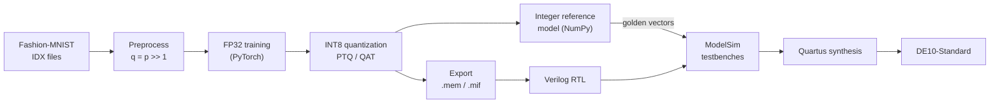
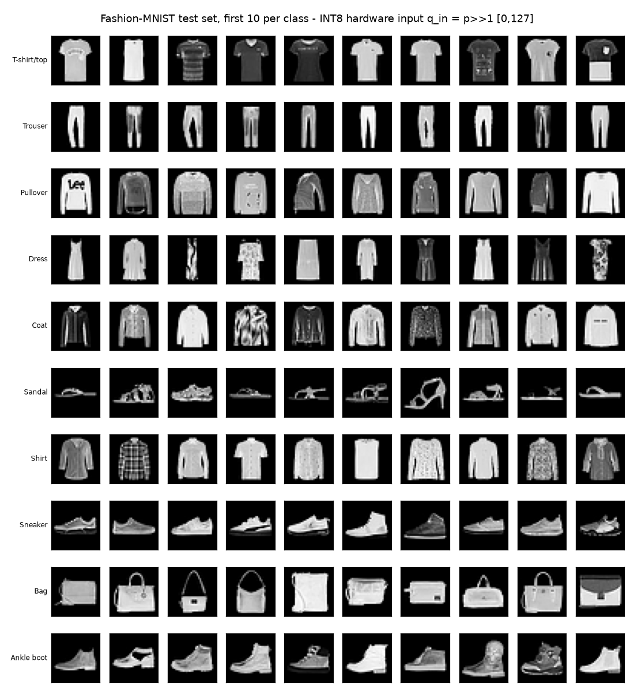
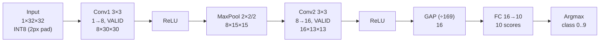
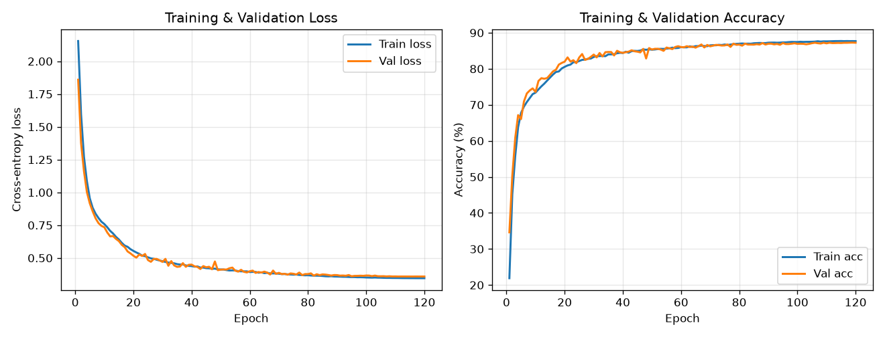
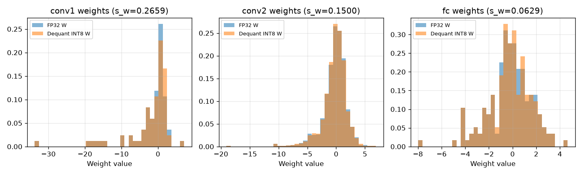
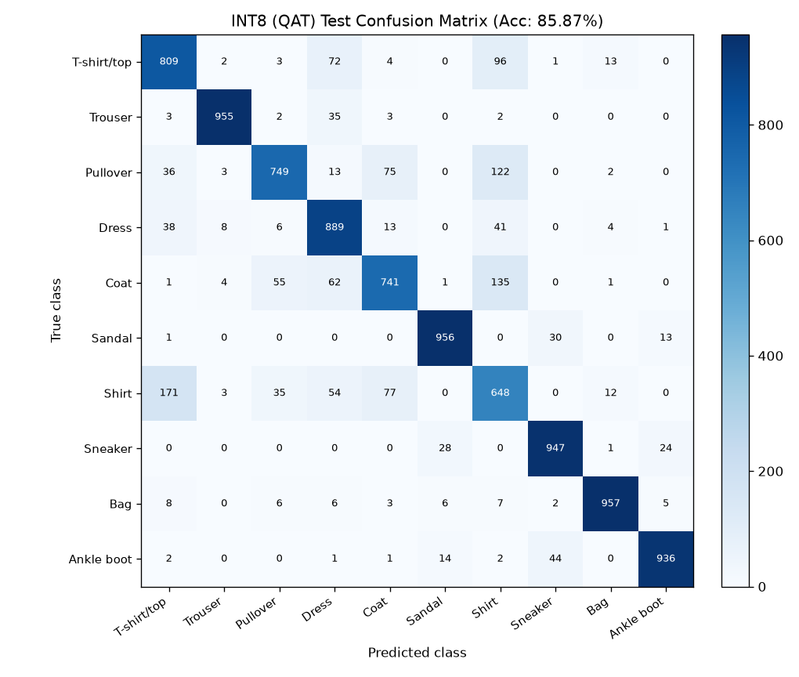
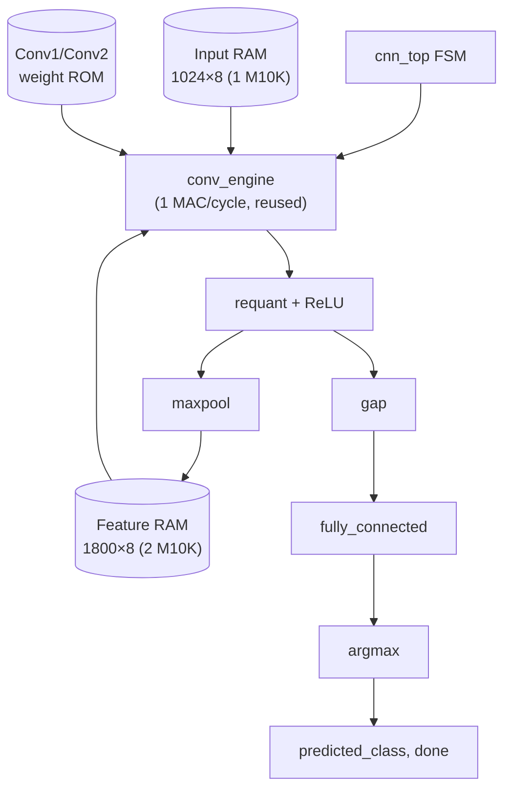

# CNN Image Classification Accelerators on Intel Cyclone V SoC FPGA (Project 1 & Project 2)

An end-to-end hardware-software co-design repository implementing **two complete INT8 CNN image classifiers** on the **Terasic DE10-Standard** (Intel Cyclone V SX SoC `5CSXFC6D6F31C6`) targeting the **30th LSI Design Contest in Hokkaido (2027)**:

| Feature | Project 1 / Method 1 (Baseline) | Project 2 / Method 2 (Parallel + HPS) |
|---|---|---|
| **Dataset** | Fashion-MNIST (`32×32×1` padded Grayscale) | **CIFAR-10 (`32×32×3` Native RGB)** |
| **CNN Topology** | 2-Layer Sequential (`1,418` params) | **4-Layer Parallel (`61,162` params)** |
| **INT8 Test Accuracy** | `85.87%` *(Fashion-MNIST)* | **`83.54%`** *(CIFAR-10)* / `84.00%` *(100 HW vectors)* |
| **Hardware Engine** | 1-MAC/cycle (`302,978` cycles = `6.06 ms` / `165 FPS`) | **2-Line Buffer + `4×9` MACs (`202,538` cycles = `4.05 ms` / `246.9 FPS`)** |
| **ARM HPS & Displays** | FPGA-only + Grayscale VGA + PS/2 + JTAG | **ARM Cortex-A9 HPS (`0xFF200000`) + 24-bit RGB VGA + `128×64` HPS LCD + JTAG** |
| **Documentation** | Sections 1–14 below | **[Section 15](#15-method-2-upgrade--cifar-10-rgb-4-layer-parallel-cnn--hps-lcdvga)** & **[`PROJECT%20JUDUL%20%202/method2/README.md`](PROJECT%20JUDUL%20%202/method2/README.md)** |

---

## Project 1 (Method 1): Two-Layer Fashion-MNIST Baseline

Python/PyTorch is used only for dataset preparation, training, quantization, weight export, and bit-exact software reference models. In Project 1, the ARM HPS is **not** used to run the network (see **Project 2 / Method 2** in [Section 15](#15-method-2-upgrade--cifar-10-rgb-4-layer-parallel-cnn--hps-lcdvga) for full ARM HPS + CIFAR-10 RGB integration).

> **Project 1 Status:** Complete (FP32 test accuracy: **86.56%**, QAT INT8 test accuracy: **85.87%**, ModelSim 18.1 **0 mismatches** across **11,731** elements, **302,978** cycles/image, Quartus synthesis **804 ALMs (`2%`)**, deployed on DE10-Standard). See [milestone log](docs/development_plan.md).

> **Project 2 / Method 2 Status:** Complete & Deployed on DE10-Standard! (`83.54%` INT8 on CIFAR-10, **`100/100`** ModelSim bit-exact parity, **`202,538` cycles (`4.051 ms` @ `50 MHz` = `246.9 FPS`)**, full ARM HPS `0xFF200000` + 24-bit RGB VGA + `128×64` HPS LCD). See **[Section 15](#15-method-2-upgrade--cifar-10-rgb-4-layer-parallel-cnn--hps-lcdvga)** and **[`PROJECT%20JUDUL%20%202/method2/README.md`](PROJECT%20JUDUL%20%202/method2/README.md)**.

---

## Contents

1. [Objectives](#1-objectives)
2. [Repository layout](#2-repository-layout)
3. [Environment setup](#3-environment-setup)
4. [Dataset](#4-dataset)
5. [CNN architecture](#5-cnn-architecture)
6. [Training](#6-training) (Milestone 3)
7. [Quantization](#7-quantization) (Milestone 4)
8. [Memory format](#8-memory-format) (Milestone 5)
9. [Integer reference model](#9-integer-reference-model) (Milestone 6)
10. [RTL architecture](#10-rtl-architecture) (Milestones 7–9)
11. [ModelSim simulation](#11-modelsim-simulation) (Milestones 8–9)
12. [Quartus synthesis](#12-quartus-synthesis) (Milestone 10)
13. [Hardware deployment](#13-hardware-deployment) (Milestone 10)
14. [Milestone status](#14-milestone-status)

---

## 1. Objectives

- Learn and document the complete FPGA CNN inference flow: data → training →
  INT8 quantization → memory export → bit-exact reference → RTL → simulation
  → synthesis → board.
- Keep a single arithmetic convention from Python to Verilog:
  - signed INT8 weights and activations
  - INT32 accumulators and biases
  - explicit requantization with documented rounding and saturation
- Prefer correctness, readability and reproducibility over early
  optimization: one sequential MAC engine, on-chip M10K memories, no DDR.



## 2. Repository layout

Directories marked *(planned)* are created at the milestone shown.

```text
fpga_midterm/
├── README.md                    this file
├── requirements.txt             Python deps (PyTorch installed separately)
├── .gitignore
├── docs/
│   ├── development_plan.md      milestones, decisions, status log
│   ├── preprocessing.md         dataset + input conversion spec        (M1)
│   ├── tensor_dimensions.md     every tensor shape, MACs, memory sizes (M1)
│   ├── quantization_spec.md     scales, shifts, rounding, saturation   (M4)
│   ├── memory_map.md            .mem/.mif layouts and address maps     (M5)
│   └── rtl_architecture.md      block diagrams, FSM, timing            (M7)
├── sw/                          Python package, run as `python -m sw.<module>`
│   ├── config.py                paths + numeric conventions (single source of truth)
│   ├── data/                    download, IDX parser, preprocessing, split   (M1)
│   ├── model/                   PyTorch CNN + shape checks                   (M2)
│   ├── train/                   FP32 training, evaluation & confusion matrix (M3)
│   ├── quant/                   PTQ / QAT, integer parameter extraction      (M4)
│   ├── export/                  .mem/.mif writers + read-back verification   (M5)
│   ├── refmodel/                bit-exact integer inference + golden vectors (M6)
│   └── tests/                   automated tests per milestone
├── data/
│   ├── raw/                     downloaded .gz files     (git-ignored)
│   ├── processed/               regenerated .npz files   (git-ignored)
│   └── splits/                  train/val indices        (tracked)
├── checkpoints/                 trained models           (M3, git-ignored)
├── mem/                         exported .mem / .mif     (M5)
├── rtl/                         synthesizable Verilog-2001 (M7)
├── sim/
│   ├── tb/                      testbenches              (M8)
│   ├── do/                      ModelSim .do scripts     (M8)
│   └── vectors/                 golden input/output vectors (M6)
├── quartus/                     DE10-Standard project, .qsf, .sdc (M10, planned)
└── reports/
    ├── dataset/                 M1 statistics and figures
    ├── model/                   M2 shapes, parameter & MAC summary
    ├── training/                M3 logs, curves, confusion matrix & report
    ├── quantization/            M4 INT8 vs FP32 report, scales & plots
    ├── export/                  M5 .mem/.mif verification summary
    ├── refmodel/                M6 integer reference model & golden vectors report
    ├── simulation/              M8–M9 ModelSim verification logs & reports
    └── synthesis/               M10 (planned, kept separate from simulation)
```

## 3. Environment setup

```powershell
# from the repository root
python -m pip install -r requirements.txt       # numpy, matplotlib, pytest
```

PyTorch 2.11.0+cu128 is installed and verified on the NVIDIA GeForce RTX 5050
Laptop GPU (`sm_12.0`). To install on another machine:

```powershell
# CUDA 12.8 build (needed for Blackwell RTX 50-series GPUs)
python -m pip install torch torchvision --index-url https://download.pytorch.org/whl/cu128
# or CPU-only
python -m pip install torch torchvision --index-url https://download.pytorch.org/whl/cpu
```

HDL tools found on the machine:

- ModelSim Intel FPGA Starter Edition 18.1 (`C:\intelFPGA_lite\18.1\modelsim_ase`)
- Questa FSE 24.1std
- Quartus Prime Lite 18.1 and 24.1std

## 4. Dataset

Full specification: [docs/preprocessing.md](docs/preprocessing.md).
Generated report: [reports/dataset/dataset_report.md](reports/dataset/dataset_report.md).

- **Source:** official Fashion-MNIST IDX files, downloaded automatically. Each
  file is MD5-verified against the checksums published by Zalando Research.
- **Splits:**

  | Split | Images | Per class | Origin |
  |---|---|---|---|
  | train | 54,000 | 5,400 | official train minus val |
  | val | 6,000 | 600 | stratified, seed 42, indices saved in `data/splits/` |
  | test | 10,000 | 1,000 | official test set |

- **Input conversion (the Python ↔ FPGA contract):**
  Each `28×28` image is symmetrically zero-padded with a 2-pixel border to
  **`32×32`** (for LSI Design Contest 2027 compatibility and exact `1,024 × 8b`
  M10K BRAM alignment), then converted via `q_in = pixel >> 1` into INT8 values
  in `[0, 127]`. The FP32 model is trained on `x = q_in / 128` (scale 2⁻⁷, zero
  point 0), so float and hardware inputs are identical up to an exact
  power-of-two scale.
- **Hardware test vectors:** the first 10 test images of each class (100
  images, `32×32` INT8), with labels. They are written to `test_image.mem` in
  Milestone 5.

Reproduce:

```powershell
python -m sw.data.prepare_dataset    # download + MD5 check + split + 32x32 pad + INT8 conversion
python -m sw.data.inspect_dataset    # statistics + figures -> reports/dataset/
python -m sw.tests.test_m1_data      # 12 automated checks
```



## 5. CNN architecture

Full table with MACs, memory and accumulator-range analysis:
[docs/tensor_dimensions.md](docs/tensor_dimensions.md).



| Stage | Output (C×H×W) | Params | MACs |
|---|---|---|---|
| Input (2px zero-padded) | 1×32×32 | – | – |
| Conv1 + ReLU | 8×30×30 | 80 | 64,800 |
| MaxPool | 8×15×15 | – | – |
| Conv2 + ReLU | 16×13×13 | 1,168 | 194,688 |
| GAP (13×13 = 169) | 16 | – | – |
| FC | 10 | 170 | 160 |
| **Total** | | **1,418** | **259,648** |

Worst-case accumulator magnitude is about 1.17 M (Conv2, 22 bits), so INT32
accumulation cannot overflow. The analytical latency estimate is
~260 k cycles ≈ 5.2 ms at 50 MHz with one MAC per cycle. This is an estimate,
not a measurement.

PyTorch implementation: [`sw/model/cnn.py`](sw/model/cnn.py).
Generated verification report: [`reports/model/model_summary.md`](reports/model/model_summary.md).

Reproduce Milestone 2 verification:

```powershell
python -m sw.model.summary           # verify shapes, param count (1,418), size (5,672 B FP32 / 1,520 B INT8) & GPU parity
python -m sw.tests.test_m2_model     # 14 automated checks
```

## 6. Training

Full report, per-class accuracy, and confusion matrix:
[`reports/training/training_report.md`](reports/training/training_report.md).

- **Training setup:** 120 epochs on NVIDIA GeForce RTX 5050 Laptop GPU (~100 s total),
  batch size 128, AdamW + `OneCycleLR` (`max_lr = 0.01`), Kaiming normal
  initialization, trained directly on the hardware-grid inputs
  `x = (pixel >> 1) / 128` (`1 × 32 × 32`).
- **Measured FP32 Baseline Results:**

  | Split | Samples | Cross-Entropy Loss | FP32 Accuracy | Correct / Total |
  |---|---|---|---|---|
  | **Train** | 54,000 | 0.3458 | **87.69%** | 47,350 / 54,000 |
  | **Validation** | 6,000 | 0.3588 | **87.27%** | 5,236 / 6,000 |
  | **Test (official `t10k`)** | 10,000 | 0.3854 | **86.56%** | 8,656 / 10,000 |
  | **Hardware test vectors** | 100 | – | **85.0%** | 85 / 100 |

Reproduce:

```powershell
python -m sw.train.train --epochs 120   # train FP32 model -> checkpoints/fp32_best.pt
python -m sw.train.evaluate             # evaluate train/val/test -> reports/training/
python -m sw.tests.test_m3_train        # 4 automated checks
```




## 7. Quantization

Full specification: [`docs/quantization_spec.md`](docs/quantization_spec.md).
Generated report: [`reports/quantization/quantization_report.md`](reports/quantization/quantization_report.md).

- **Hardware-exact arithmetic:**
  - Signed `INT8` weights (`[-127, 127]`) and activations (`[0, 127]` post-ReLU, `[-128, 127]` FC scores), zero point `0`.
  - Signed `INT32` accumulators and biases (`s_b = s_in * s_w`).
  - Dyadic requantization with 16-bit unsigned multiplier $M \in [1, 65535]$ (fits in a single Cyclone V 18×18 DSP block) and arithmetic shift $n$:
    `y = sat8((int64(acc) * M + (1 << (n - 1))) >>> n)` (round-half-up).
  - Global Average Pooling (`÷ 169`) folds the exact reciprocal and dynamic-range rescaling $s_{a2} \to s_{gap}$ into a single multiply-shift (`M_gap = 16780, n_gap = 19`).
- **Measured FP32 vs INT8 Accuracy:**

  | Split | FP32 Baseline | PTQ INT8 | QAT INT8 (Selected) | Delta vs FP32 | INT8 ↔ FP32 Agreement |
  |---|---|---|---|---|---|
  | **Train (54,000)** | 87.69% | – | **86.84%** | -0.85% | 95.65% |
  | **Validation (6,000)** | 87.27% | 85.78% | **86.97%** | -0.30% | 96.00% |
  | **Test (10,000)** | 86.56% | 85.02% | **85.87%** | **-0.69%** | **95.49%** |
  | **HW Test Vectors (100)** | 85.0% | – | **82.0%** | -3.0% | 93.0% |

Reproduce:

```powershell
python -m sw.quant.evaluate_quant    # PTQ + QAT + full evaluation -> checkpoints/int8_quantized.npz
python -m sw.tests.test_m4_quant     # 7 automated checks
```





## 8. Memory format

Full memory layout and address mapping: [`docs/memory_map.md`](docs/memory_map.md).
Generated report: [`reports/export/export_report.md`](reports/export/export_report.md).

- **Exported files (`mem/`):**
  - `conv1_weights.mem` / `.mif` (depth 72, width 8b, `INT8` two's-complement hex)
  - `conv1_bias.mem` / `.mif` (depth 8, width 32b, `INT32` two's-complement hex)
  - `conv2_weights.mem` / `.mif` (depth 1,152, width 8b, `INT8` two's-complement hex)
  - `conv2_bias.mem` / `.mif` (depth 16, width 32b, `INT32` two's-complement hex)
  - `fc_weights.mem` / `.mif` (depth 160, width 8b, `INT8` two's-complement hex)
  - `fc_bias.mem` / `.mif` (depth 10, width 32b, `INT32` two's-complement hex)
  - `quantization_params.mem` / `.mif` (depth 8, width 32b: `(M, n)` pairs for `conv1`, `conv2`, `gap`, `fc`)
  - `test_image.mem` / `.mif` (depth 1,024, width 8b: `32×32` zero-padded INT8 test image)
  - `test_images_100.mem` & `test_labels_100.mem` (all 100 hardware test vectors for batch simulation)
- **Verification:** Every `.mem` and `.mif` file is read back into Python, its `DEPTH`/`WIDTH`/`ADDRESS_RADIX`/`DATA_RADIX`/`CONTENT` declarations validated, and every element compared bit-for-bit against the original quantized tensors.

Reproduce:

```powershell
python -m sw.export.export_mem       # export all .mem & .mif files + read-back verification
python -m sw.tests.test_m5_export    # 6 automated checks
```

## 9. Integer reference model

Implementation: [`sw/refmodel/int8_ref_model.py`](sw/refmodel/int8_ref_model.py).
Generated report: [`reports/refmodel/refmodel_report.md`](reports/refmodel/refmodel_report.md).

- **Strictly integer-only:** Loads weights, biases, and `(M, n)` parameters directly from `mem/*.mem` and executes `INT8` / `INT32` / `INT64` hardware arithmetic with zero floating-point types or PyTorch calls.
- **Dual verification modes:**
  1. `infer_single_hw_loop`: explicit nested loops using the 1D hardware memory address equations (`addr = ((oc * C_in + ic) * 3 + ky) * 3 + kx`, `addr = (c * H + y) * W + x`, `addr = (oc << 4) | ic`).
  2. `infer_batch_int8`: vectorized pure-integer NumPy implementation, verified bit-for-bit identical to `infer_single_hw_loop` and to Milestone 4 across all **10,000** test images (**85.87%** test accuracy, `8,587 / 10,000`).
- **Golden ModelSim vectors (`sim/vectors/`):** 15 `.mem` files covering every intermediate hardware stage (`img0_conv1_acc.mem`, `img0_conv1_req.mem`, `img0_relu1_out.mem`, `img0_pool1_out.mem`, `img0_conv2_acc.mem`, `img0_conv2_req.mem`, `img0_relu2_out.mem`, `img0_gap_sum.mem`, `img0_gap_out.mem`, `img0_fc_acc.mem`, `img0_fc_scores.mem`, `img0_expected_class.mem`, plus 100-image batch vectors).

Reproduce:

```powershell
python -m sw.refmodel.generate_vectors   # run integer refmodel + export sim/vectors/*.mem
python -m sw.tests.test_m6_refmodel      # 5 automated checks
```

## 10. RTL architecture

Full specification, synchronous M10K BRAM timing (`S_PRE -> S_PIPE -> S_MAC -> S_REQUANT`), and cycle-count breakdown: [`docs/rtl_architecture.md`](docs/rtl_architecture.md).

- **Implemented synthesizable Verilog-2001 modules (`rtl/`):**
  - [`rtl/conv_engine.v`](rtl/conv_engine.v) — Reusable sequential 3×3 VALID 2D convolution + INT32 bias + dyadic requantization engine (time-multiplexed across Conv1 `1×32×32 → 8×30×30` and Conv2 `8×15×15 → 16×13×13`).
  - [`rtl/relu.v`](rtl/relu.v) — Signed `INT8` ReLU (`max(0, x)`), providing both combinational and 1-cycle registered outputs.
  - [`rtl/maxpool.v`](rtl/maxpool.v) — 2×2 stride-2 signed `INT8` MaxPool (`8×30×30 → 8×15×15`).
  - [`rtl/gap.v`](rtl/gap.v) — Global Average Pooling over `13×13 = 169` elements per channel (`16×13×13 → 16`) with exact dyadic multiply-shift rounding (`M_gap = 16780, n_gap = 19`).
  - [`rtl/fully_connected.v`](rtl/fully_connected.v) — `16 → 10` Fully Connected layer with signed `INT8` MAC, `INT32` bias, and dyadic requantization (`M_fc = 23793, n_fc = 21`).
  - [`rtl/argmax.v`](rtl/argmax.v) — 10-class signed `INT8` Argmax with lowest-index tie-breaking (`0..9`).
  - [`rtl/cnn_top.v`](rtl/cnn_top.v) — Top-level accelerator (`clk, rst, start, done, predicted_class [3:0]`), on-chip M10K BRAM buffers, and master FSM controller.
- **Compilation status:** All 7 modules compiled cleanly in ModelSim Intel FPGA Edition 18.1 (`vlog 10.5b`) with **0 errors and 0 warnings**.



## 11. ModelSim simulation

Unit verification report: [`reports/simulation/unit_verification_report.md`](reports/simulation/unit_verification_report.md).
Transcript log: [`reports/simulation/unit_tests_transcript.log`](reports/simulation/unit_tests_transcript.log).

- **Milestone 8 (Individual Module Unit Testbenches — Complete):**
  - [`sim/tb/tb_conv_engine.v`](sim/tb/tb_conv_engine.v) — Conv1 (`7,200` `INT32` accumulators + `7,200` `INT8` outputs, `86,401` cycles) & Conv2 (`2,704` `INT32` accumulators + `2,704` `INT8` outputs, `202,801` cycles): **0 mismatches**.
  - [`sim/tb/tb_relu.v`](sim/tb/tb_relu.v) — Exhaustive `[-128..+127]` sweep (`256` combinational + `256` registered) + `7,200` ReLU1 + `2,704` ReLU2 (`10,160` cycles): **0 mismatches**.
  - [`sim/tb/tb_maxpool.v`](sim/tb/tb_maxpool.v) — Directed `1×4×4` signed negative/zero/positive test (`4` outputs) + Pool1 `8×30×30 → 8×15×15` (`1,800` outputs, `10,801` cycles): **0 mismatches**.
  - [`sim/tb/tb_gap.v`](sim/tb/tb_gap.v) — `16×13×13 → 16` GAP (`16` `INT32` sums + `16` `INT8` outputs, `2,753` cycles): **0 mismatches**.
  - [`sim/tb/tb_fully_connected.v`](sim/tb/tb_fully_connected.v) — `16 → 10` FC (`10` `INT32` accumulators + `10` `INT8` scores, `191` cycles): **0 mismatches**.
  - [`sim/tb/tb_argmax.v`](sim/tb/tb_argmax.v) — Image 0 golden scores + tie-breaking + all-negative scores + class-9 winner (`13` cycles/run): **0 mismatches**.
- **Milestone 9 (Complete CNN Integration Verification — Complete):**
  - Integration report: [`reports/simulation/cnn_top_verification_report.md`](reports/simulation/cnn_top_verification_report.md)
  - Transcript log: [`reports/simulation/cnn_top_transcript.log`](reports/simulation/cnn_top_transcript.log)
  - Testbench & `.do` script: [`sim/tb/tb_cnn_top.v`](sim/tb/tb_cnn_top.v), [`sim/do/run_tb_cnn_top.do`](sim/do/run_tb_cnn_top.do)
  - **Phase 1 (Image 0 Layer-by-Layer Buffer Verification):** `11,731 / 11,731` internal BRAM elements matched the Python integer reference model (`7,200` Conv1+ReLU1 + `1,800` Pool1 + `2,704` Conv2+ReLU2 + `16` GAP + `10` FC scores + `1` Argmax class), **0 mismatches, Max Abs Error = 0**.
  - **Phase 2 (10-Class Multi-Image End-to-End Sweep):** `10 / 10` images (`Vec 0, 10, 20, ..., 90`) matched the Python integer reference model (`100.0%` classification agreement, `0 / 100` FC score mismatches).
  - **Measured Latency:** **`302,978` clock cycles per image** (`6.060 ms` @ 50 MHz, `3.030 ms` @ 100 MHz).

Reproduce Milestone 8 & 9 ModelSim simulations:

```powershell
& "C:\intelFPGA_lite\18.1\modelsim_ase\win32aloem\vsim.exe" -c -do sim/do/run_all_unit_tbs.do -l reports/simulation/unit_tests_transcript.log
& "C:\intelFPGA_lite\18.1\modelsim_ase\win32aloem\vsim.exe" -c -do sim/do/run_tb_cnn_top.do -l reports/simulation/cnn_top_transcript.log
python -m sw.tests.test_m8_unit_sim
python -m sw.tests.test_m9_cnn_top_sim
```

## 12. Quartus synthesis

Synthesis report: [`reports/synthesis/synthesis_report.md`](reports/synthesis/synthesis_report.md).

- **Quartus Prime 18.1 (`quartus/de10_standard.qpf`, `5CSXFC6D6F31C6`):**
  - **Logic Utilization:** `804 / 41,910` ALMs (`1.92%` ≈ `2%`), `1,323` ALUTs, `646` registers
  - **Memory & DSPs:** `31 / 553` M10K blocks (`5.61%`, `186,192` bits) + `22 / 112` DSP blocks (`19.64%` ≈ `20%`)
  - **Timing (`CLOCK_50` = 50 MHz):** **PASS (0 violations)** — Slow `85°C` setup slack `+5.254 ns` (`Fmax = 67.82 MHz`), Slow `0°C` setup slack `+5.057 ns` (`Fmax = 66.92 MHz`)

## 13. Hardware deployment

- **Physical DE10-Standard Verification (`DE-SoC [USB-1]`, JTAG ID `0x02D020DD`):** Programmed [`quartus/output_files/de10_standard.sof`](quartus/output_files/de10_standard.sof) (`checksum 0x015EDB97`), verified all 10 `SW[3:0]` ROM classes (`0 - P A S 0` .. `9 - P A S 9`), `SW[9]` cycle counter (`302978`), PS/2 mouse canvas, `640×480` VGA HUD, and live 272-bit row-burst USB-JTAG GUI (`python -m sw.gui_app`).

## 14. Milestone status

| # | Milestone | Status |
|---|---|---|
| 1 | Dataset download, inspection, preprocessing (`32×32` zero-padded) | ✅ Done (12/12 tests pass) |
| 2 | PyTorch model and tensor shape verification (`32×32` input) | ✅ Done (14/14 tests pass) |
| 3 | FP32 training and evaluation (**86.56%** test acc) | ✅ Done (4/4 tests pass) |
| 4 | INT8 quantization and evaluation (**85.87%** QAT / **85.02%** PTQ test acc) | ✅ Done (7/7 tests pass) |
| 5 | `.mem` / `.mif` export (read-back verified) | ✅ Done (6/6 tests pass) |
| 6 | Python integer reference model & golden vectors | ✅ Done (5/5 tests pass) |
| 7 | Individual Verilog-2001 modules (`rtl/*.v`) | ✅ Done (4/4 tests pass; ModelSim `vlog`: 0 errors, 0 warnings) |
| 8 | Individual ModelSim unit testbenches (`sim/tb/tb_*.v`) | ✅ Done (6/6 testbenches pass, 0 mismatches; 2/2 pytest checks pass) |
| 9 | Complete CNN integration and verification (`tb_cnn_top.v`) | ✅ Done (11,731/11,731 elements match, 10/10 class agreement, 302,978 cycles; 2/2 pytest checks pass) |
| 10 | Quartus synthesis and DE10-Standard testing | ✅ Done (`804` ALMs = `2%`, `31` M10Ks, `22` DSPs, `+5.057 ns` slack, live VGA + PS/2 + JTAG GUI) |

Details, decisions and test logs: [docs/development_plan.md](docs/development_plan.md).


---

## 15. Method 2 Upgrade — CIFAR-10 RGB 4-Layer Parallel CNN + HPS LCD/VGA

> All Method 1 files and sections (Sections 1–14) remain **100% untouched**. Method 2 is implemented in parallel (`sw_m2/`, `rtl_m2/`, `sim_m2/`, `mem_m2/`, `hps_m2/`, `quartus_m2/`, `reports_m2/`) and archived in [`PROJECT%20JUDUL%20%202/method2/`](PROJECT%20JUDUL%20%202/method2/README.md).

### 15.1 Method 1 vs. Method 2 Comparison

| Metric | Method 1 (Baseline) | Method 2 (Parallel + HPS) |
|---|---|---|
| **Dataset & Input** | Fashion-MNIST (`32×32×1` Grayscale) | **CIFAR-10 (`32×32×3` Native RGB)** |
| **Input Quantization** | `q_in = pixel >> 1 ∈ [0, 127]` (`0` gates) | **`q_in = pixel - 128 ∈ [-128, 127]` (MSB flip, `0` gates)** |
| **CNN Architecture** | 2-Layer (`1→8→Pool→8→16→GAP→FC`) | **4-Layer (`3→16→Pool→32→Pool→64→64→GAP→FC`)** |
| **Total Parameters** | `1,418` | **`61,162` (`43.1×`)** |
| **Quantization** | Per-Layer Symmetric INT8 QAT | **BatchNorm Folding + Per-Channel Symmetric INT8 QAT** |
| **INT8 Test Accuracy** | `85.87%` *(Fashion-MNIST)* | **`83.54%`** *(CIFAR-10)* / `84.00%` *(100 HW vectors)* |
| **Conv Engine** | Sequential 1-MAC/cycle | **2-Line Shift-Register Line Buffer + `4×9 = 36` Parallel MACs (`Po=4`)** |
| **Latency / FPS @ 50 MHz** | `302,978` cycles (`6.060 ms` / `165.0 FPS`) | **`202,538` cycles (`4.051 ms` / `246.9 FPS`)** |
| **ModelSim 18.1 Parity** | `100 / 100` preds, `1,000 / 1,000` scores | **`100 / 100` preds, `1,000 / 1,000` scores** |
| **Quartus Resources (`5CSXFC6D6F31C6`)** | `804` ALMs (`2%`), `31` M10Ks (`6%`), `22` DSPs | `3,815` ALMs (`9%` FPGA) / `8,149` ALMs (`19%` incl. HPS), `103` M10Ks (`19%`), `52` DSPs (`46%`) |
| **Hardware Displays & Bridge** | VGA Grayscale + PS/2 + JTAG | **VGA 24-bit RGB HUD + HPS `128×64` LCD + Lightweight AXI (`0xFF200000`) + JTAG** |

### 15.2 Dataset, 4-Layer CNN & Quantization Results

- **CIFAR-10 (`32×32×3` RGB):** Deterministic `45,000` train / `5,000` val (`SEED=42`) / `10,000` test split + `100` balanced hardware test vectors (`10` per class: `airplane`, `automobile`, `bird`, `cat`, `deer`, `dog`, `frog`, `horse`, `ship`, `truck`).
- **Two-Stage Training (`sw_m2/train_qat.py`):**
  1. **Float32 + BatchNorm2d (80 epochs):** `SGD(lr=0.05, momentum=0.9)` + `CosineAnnealingLR` + `RandomCrop(32, padding=4)` + `RandomHorizontalFlip()`.
  2. **BatchNorm Folding + Per-Channel INT8 QAT (25 epochs):** Folds `gamma, beta, mean, var` into Conv weights/biases, fine-tunes with `Adam(lr=2e-4)`, and exports per-channel dyadic `(mult, shift)` parameters.

| Split | FP32 (Float+BN) | QAT Fake-Quant | Pure INT8 (FPGA-Exact) | Delta vs. FP32 |
|---|---|---|---|---|
| **Train (`45,000`)** | – | – | **`87.93%`** | – |
| **Validation (`5,000`)** | `84.18%` | `84.34%` | **`84.02%`** | `-0.16%` |
| **Test (`10,000`)** | `83.49%` | `83.61%` | **`83.54%`** | **`+0.05%`** |
| **HW Test Vectors (`100`)** | – | – | **`84.00%`** | – |


*Figure 15.1 — 10×10 grid of all 100 balanced CIFAR-10 hardware test vectors (`32×32×3` RGB, first 10 test images per class from `airplane` to `truck`), quantized with zero-gate MSB-flip (`q_in = pixel - 128 ∈ [-128, 127]`).*


*Figure 15.2 — Pure INT8 Confusion Matrix across all 10,000 official CIFAR-10 test images (**83.54%** accuracy). Highest per-class accuracies are `automobile` (`934/1,000` = `93.4%`), `ship` (`914/1,000` = `91.4%`), `truck` (`888/1,000` = `88.8%`), and `frog` (`881/1,000` = `88.1%`), while visually similar `cat` (`684/1,000`) and `dog` (`740/1,000`) account for most cross-confusions.*


*Figure 15.3 — Weight distribution histograms comparing **FP32 (BatchNorm-Folded)** (blue) vs. **Dequantized Per-Channel INT8** (orange) across `CONV1`, `CONV2`, `CONV3`, `CONV4`, and `FC`. The near-complete overlap confirms minimal quantization distortion (`+0.05%` test delta vs. FP32).*


*Figure 15.4 — Hardware performance comparison at `50 MHz`: Method 2 cuts latency from `302,978` cycles (`165.0 FPS`) down to **`202,538` cycles (`246.9 FPS`)** — **1.50× faster** despite running a **43.1× larger** 4-layer CNN (`61,162` vs. `1,418` parameters) via the 2-line buffer and `4×9 = 36` parallel MAC array.*

### 15.3 Parallel Hardware Architecture (`rtl_m2/`)

- **2-Line Shift-Register Line Buffer (`conv_engine_m2.v`):** Streams pixels in raster order through two `32`-deep line buffers (`lb0`, `lb1`), exposing all `9` pixels of the `3×3` window simultaneously every cycle with automatic `PAD=1` zero-padding.
- **`4×9 = 36` Parallel MAC Array ($P_o = 4$):** Reads `4 × 72`-bit packed `3×3` kernels (`w_bank0..3`) and `4 × 53`-bit `{shift, mult, bias}` (`q_bank0..3`) in 1 cycle, accumulates into 4-bank M10K partial-sum RAMs (`psum_ram0..3`), and applies per-channel dyadic requantization + ReLU `[0, 127]`.
- **4-Bank Ping-Pong BRAMs & `0`-DSP GAP:** `fmap_a0..3` (`16` M10Ks) and `fmap_b0..3` (`8` M10Ks) alternate across `Conv1 → Pool1 → Conv2 → Pool2 → Conv3 → Conv4`, followed by `0`-DSP `8×8` GAP (`(sum + 32) >>> 6`) and `FC (64→10) + Argmax`.

### 15.4 Cyclone V HPS (`0xFF200000`), VGA RGB HUD & `128×64` HPS LCD

- **Qsys Lightweight AXI Bridge (`hps_cnn_qsys`):** Maps `hps_0.h2f_lw_axi_master` (`0xFF200000`) to `de10_standard_top_m2.v` (`0x00` CTRL, `0x04` STATUS, `0x08` PIX_WR, `0x0C` CYCLES, `0x10..0x34` SCORE0..9, `0x38` BOARD_IO).
- **Synchronized Board Modes (`hps_m2/main_cifar10_vga_bridge.c`):**
  - **`SW[8] = 0` (Switch-Follow Mode):** Flipping `SW[3:0]` (`0..9`) or pressing `KEY[1]`/`KEY[2]` updates **both** the `640×480` 24-bit RGB VGA HUD (`vga_cnn_hud_m2.v`) and the `128×64` HPS Graphic LCD (`SW=X -> P=Y`, `4.05ms 247FPS`).
  - **`SW[8] = 1` (100-Image Slideshow Mode):** ARM Cortex-A9 streams all `100` CIFAR-10 images (`hw_images_100.bin`) over `0xFF200000` to the FPGA, VGA monitor, and HPS LCD (`HPS->VGA #XX`).
  - **`SW[9] = 1`:** Displays exact hardware clock cycles (`03172A` hex = `202,538`) on `HEX5..HEX0`.

### 15.5 Verification, Synthesis & Quick Run (Method 2)

- **ModelSim 18.1 (`sim_m2/tb_cnn_top_m2.v`):** `100 / 100` prediction parity, `1,000 / 1,000` INT8 score parity, `202,538` cycles/image (`4.051 ms` @ `50 MHz` = `246.9 FPS`).
- **Quartus Prime 18.1 (`quartus_m2/de10_standard_m2.qpf`):** `8,149 / 41,910` ALMs (`19%` incl. HPS Qsys), `103 / 553` M10Ks (`19%`), `52 / 112` DSPs (`46%`), `+3.634 ns` `CLOCK_50` setup slack (`0` timing violations).

```powershell
# 1. Python Pipeline & ModelSim + FPGA JTAG GUI
python -m sw_m2.preprocess
python -u -m sw_m2.train_qat
python -m sw_m2.export_mem
python -m sw_m2.gui_app_m2

# 2. Program DE10-Standard FPGA Bitstream
C:\intelFPGA_lite\18.1\quartus\bin64\quartus_pgm.exe -c "DE-SoC [USB-1]" -m JTAG -o "p;quartus_m2\output_files\de10_standard_m2.sof@2"
```
On DE10-Standard Angstrom Linux (`COM7`, `115200` baud):
```bash
cd /home/xuser/hps_cifar10_lcd && ./hps_vga_bridge
```

- **Full Documentation & Reports:** [`PROJECT%20JUDUL%20%202/method2/README.md`](PROJECT%20JUDUL%20%202/method2/README.md), [`method2_complete_report.pdf`](PROJECT%20JUDUL%20%202/method2/method2_complete_report.pdf), [`laporan_uts_fpga_ersha.pdf`](PROJECT%20JUDUL%20%202/method2/laporan_uts_fpga_ersha.pdf), [`lecturer_qa_100.pdf`](PROJECT%20JUDUL%20%202/method2/lecturer_qa_100.pdf).

