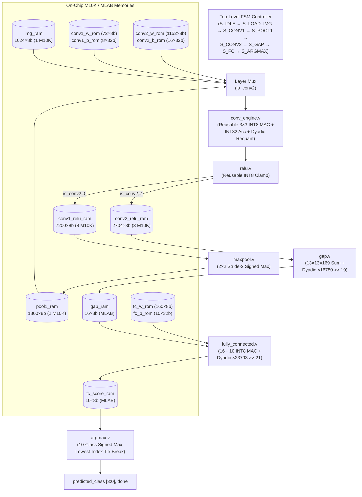

# Verilog-2001 RTL Architecture Specification (Milestone 7)

This document specifies the microarchitecture, port interfaces, memory timing,
and FSM control flow of the two-layer CNN accelerator implemented in
synthesizable Verilog-2001 (`rtl/*.v`) for the **Terasic DE10-Standard**
(Intel Cyclone V SoC FPGA).

---

## 1. Top-Level Block Diagram (`rtl/cnn_top.v`)

---

## 2. Synchronous M10K BRAM Timing Discipline (`S_PRE -> S_PIPE -> S_MAC`)

Intel Cyclone V M10K blocks require synchronous read addresses and produce
registered read data 1 clock cycle after the address is latched by the memory.
Because our RTL modules also register their outgoing read addresses
(`in_rd_addr`, `w_rd_addr`, `b_rd_addr`) for clean Fmax timing closure, there
is an exact **2-edge pipeline latency** from asserting an address register to
capturing the returned `in_rd_data`:

1. **`S_PRE` (Cycle 0):** Module registers `rd_addr <= addr(0)` and `b_rd_addr <= oc`.
2. **`S_PIPE` (Cycle 1):** Synchronous BRAM/ROM latches `rd_data <= mem[addr(0)]`; simultaneously, the module registers `rd_addr <= addr(1)`.
3. **`S_MAC` / `S_ACCUM` (Cycles 2 .. $N+1$):** On every single clock cycle (`1 MAC/cycle`), `rd_data` holds `mem[addr(k)]`, which is multiplied/accumulated while `rd_addr <= addr(k+2)` is pipelined ahead.
4. **`S_REQUANT` (Cycle $N+2$):** Applies the 64-bit dyadic multiply-add-shift rounding and saturation to `INT8` and asserts `out_valid`.

---

## 3. Individual RTL Modules (`rtl/*.v`)

| File | Module Name | Function | Key Parameters & Arithmetic | Cycles per Invocation |
|---|---|---|---|---|
| [conv_engine.v](file:///c:/Users/Ersha%20Anandita/Downloads/fpga_midterm/rtl/conv_engine.v) | `conv_engine` | Reusable 3×3 VALID 2D convolution + bias + dyadic requantization | Runtime configurable (`cfg_in_c`, `cfg_in_h`, `cfg_in_w`, `cfg_out_c`, `cfg_out_h`, `cfg_out_w`, `cfg_mult`, `cfg_shift`). Emits both `out_acc_int32` and `out_req_int8` (`[-128, 127]`) with `out_valid`/`out_ready`. | Conv1: `7,200 × (9 + 3) + 1 = 86,401` cycles Conv2: `2,704 × (72 + 3) + 1 = 202,801` cycles |
| [relu.v](file:///c:/Users/Ersha%20Anandita/Downloads/fpga_midterm/rtl/relu.v) | `relu` | Signed `INT8` ReLU (`max(0, x)`) | Checks sign bit `in_data[7]`; outputs `8'sd0` if negative, else `in_data`. Provides both combinational (`out_data_comb`) and 1-cycle registered (`out_valid`, `out_addr`, `out_data`) outputs. | 1-cycle pipeline latency (streamed inline with `conv_engine`) |
| [maxpool.v](file:///c:/Users/Ersha%20Anandita/Downloads/fpga_midterm/rtl/maxpool.v) | `maxpool` | 2×2 stride-2 signed `INT8` MaxPool (`8×30×30 → 8×15×15`) | Sequentially reads `(2*py, 2*px)`, `(2*py, 2*px+1)`, `(2*py+1, 2*px)`, `(2*py+1, 2*px+1)` and compares using `$signed(a) > $signed(b)`. | `1,800 × 6 + 1 = 10,801` cycles |
| [gap.v](file:///c:/Users/Ersha%20Anandita/Downloads/fpga_midterm/rtl/gap.v) | `gap` | Global Average Pooling (`16×13×13 → 16`) | Sums `169` spatial values per channel into `INT32` (`out_sum_int32`), then computes `clamp(((int64(sum) * 16780) + 2^18) >>> 19, 0, 127)`. | `16 × (169 + 3) + 1 = 2,753` cycles |
| [fully_connected.v](file:///c:/Users/Ersha%20Anandita/Downloads/fpga_midterm/rtl/fully_connected.v) | `fully_connected` | `16 → 10` Fully Connected layer | Signed `INT8 × INT8` MAC + `INT32` bias (`out_acc_int32`), then computes `clamp(((int64(acc) * 23793) + 2^20) >>> 21, -128, 127)`. | `10 × (16 + 3) + 1 = 191` cycles |
| [argmax.v](file:///c:/Users/Ersha%20Anandita/Downloads/fpga_midterm/rtl/argmax.v) | `argmax` | 10-class signed `INT8` Argmax (`0..9`) | Scans `c = 0..9` using strict `$signed(in_rd_data) > $signed(max_score)` so ties break to the lowest class index. | `10 + 3 = 13` cycles |
| [cnn_top.v](file:///c:/Users/Ersha%20Anandita/Downloads/fpga_midterm/rtl/cnn_top.v) | `cnn_top` | Top-level CNN accelerator & FSM | Exposes `clk, rst, start, done, predicted_class [3:0]` plus optional `ext_img_wr_*` image load port. | **~302,972 clock cycles/image** (~6.06 ms at 50 MHz, ~3.03 ms at 100 MHz) |
