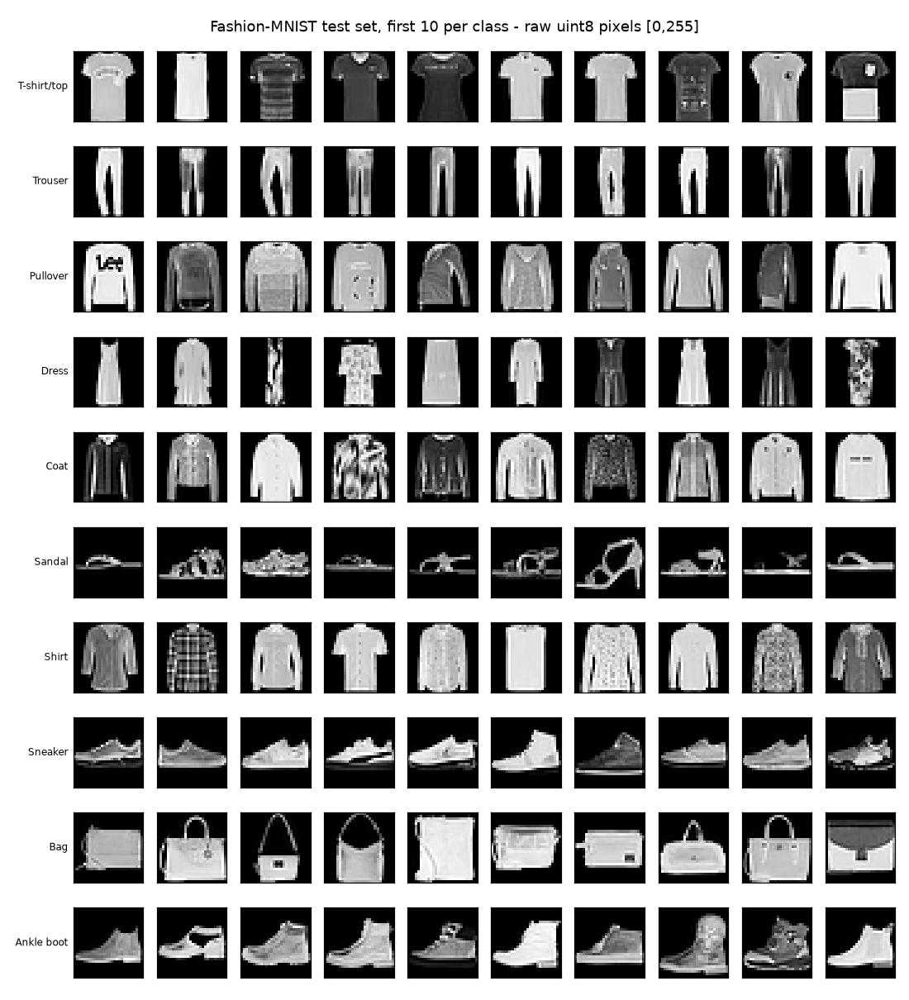
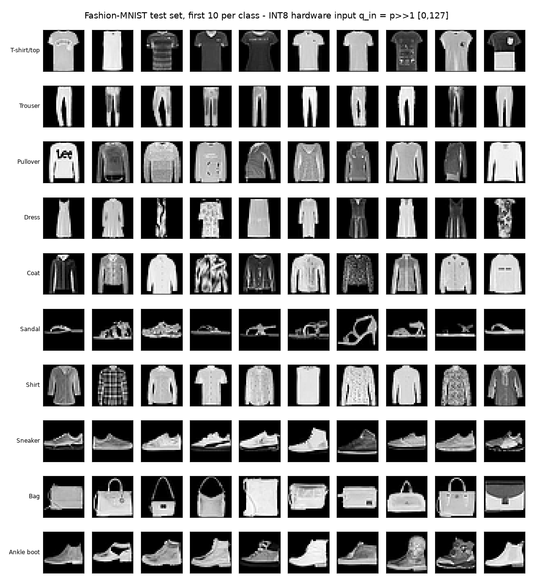
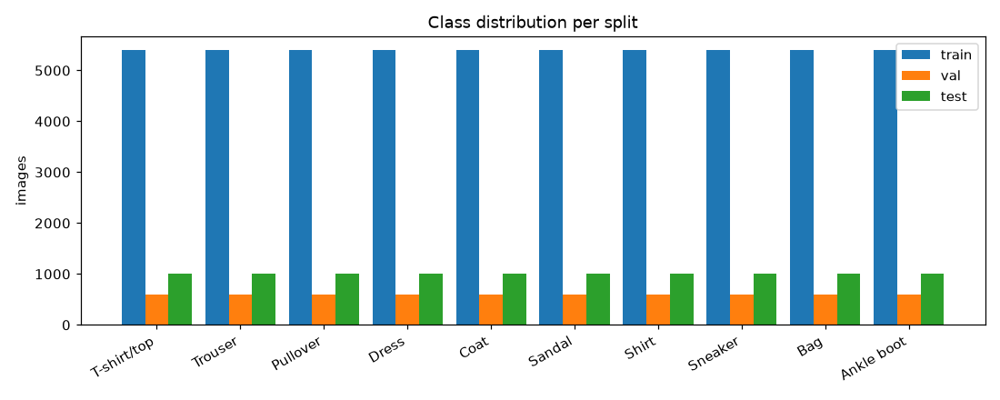
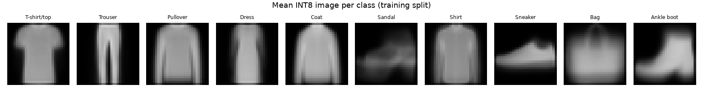
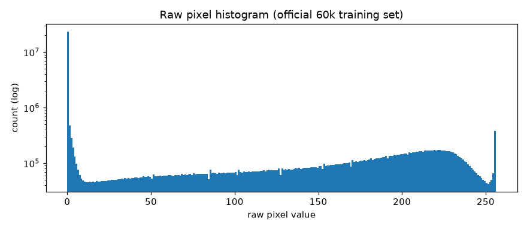

# Dataset Inspection Report (Milestone 1)

Generated by `python -m sw.data.inspect_dataset`. Do not edit by hand.

## Splits

| Split | Shape | dtype | Images per class |
|---|---|---|---|
| train | (54000, 28, 28) | int8 | [5400, 5400, 5400, 5400, 5400, 5400, 5400, 5400, 5400, 5400] |
| val | (6000, 28, 28) | int8 | [600, 600, 600, 600, 600, 600, 600, 600, 600, 600] |
| test | (10000, 28, 28) | int8 | [1000, 1000, 1000, 1000, 1000, 1000, 1000, 1000, 1000, 1000] |

## Pixel statistics

| Data | min | max | mean | std | fraction of zeros |
|---|---|---|---|---|---|
| raw train (uint8) | 0 | 255 | 72.940 | 90.021 | 0.5021 |
| raw test (uint8) | 0 | 255 | 73.147 | 89.873 | 0.4999 |
| train INT8 (q_in) | 0 | 127 | 36.317 | 44.892 | 0.5123 |
| test INT8 (q_in) | 0 | 127 | 36.445 | 44.833 | 0.5100 |

## Input conversion `q_in = p >> 1`, `x = q_in / 128`

- Distinct grey levels: 256 -> 128
- Max |x - p/255| over all 256 pixel values: 0.007812
- Mean |x - p/255| over all 256 pixel values: 0.003906
- The FP32 model is trained directly on `x = q_in / 128`, so this difference is
  *not* a mismatch between training and hardware.

## Class names

| Label | Class |
|---|---|
| 0 | T-shirt/top |
| 1 | Trouser |
| 2 | Pullover |
| 3 | Dress |
| 4 | Coat |
| 5 | Sandal |
| 6 | Shirt |
| 7 | Sneaker |
| 8 | Bag |
| 9 | Ankle boot |

## Hardware test vectors

100 images (first 10 of each class in the official test set). Official test indices of the first vector of each class:

| Class | Label | Test index |
|---|---|---|
| T-shirt/top | 0 | 19 |
| Trouser | 1 | 2 |
| Pullover | 2 | 1 |
| Dress | 3 | 13 |
| Coat | 4 | 6 |
| Sandal | 5 | 8 |
| Shirt | 6 | 4 |
| Sneaker | 7 | 9 |
| Bag | 8 | 18 |
| Ankle boot | 9 | 0 |

### Test vector 0 (test index 19, label 0 = T-shirt/top) as ASCII art

```
         :#=.  .+*.         
       =#%#%%%%@##%*-       
     :*###########*###      
     ##*############*#*     
    :##################.    
    #%####***###**#####=    
    %%###*#%#%%%%#######    
   :%%###%%#**#*##%####*:   
   +@%##%********=*%*###=   
    =%@##*=%%%@%#+%%#%#:    
      -%#%%%#####%%##=      
       %########%%%%#       
       %#######*%@%%#       
       %#########%%#*       
       %#############       
       %############*       
       %############*       
       %#############       
       %#############       
       %#############       
       %#############       
       %#############       
       %#############       
       ##############       
       ##############       
       ##############       
       #############%       
       ***#########*+       
```

## Figures










