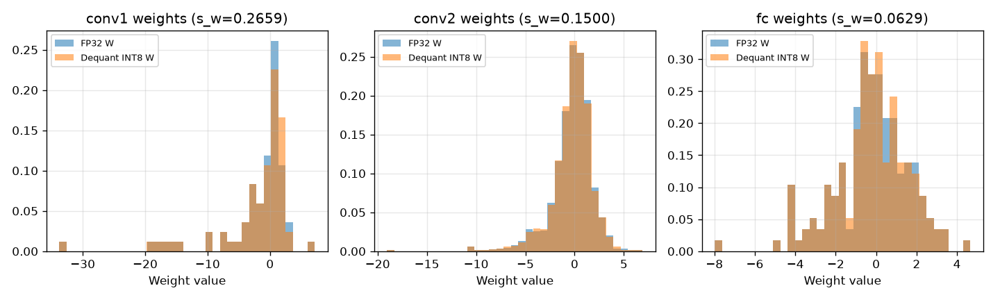
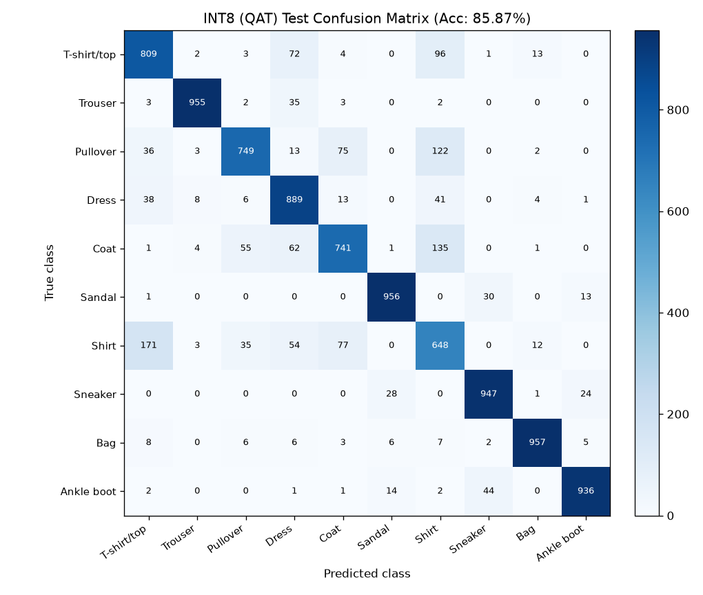

# INT8 Quantization and Evaluation Report (Milestone 4)

Generated by `python -m sw.quant.evaluate_quant`. Do not edit by hand.
Full mathematical specification: [`docs/quantization_spec.md`](../../docs/quantization_spec.md).

## 1. FP32 vs INT8 (PTQ & QAT) Accuracy Comparison

| Split | FP32 Baseline | PTQ INT8 | QAT INT8 | Selected INT8 (`QAT`) | Delta vs FP32 | Classification Agreement vs FP32 |
|---|---|---|---|---|---|---|
| **Train (54,000)** | 87.69% | – | – | **86.84%** | -0.85% | 95.65% |
| **Validation (6,000)** | 87.27% | 85.78% | 86.97% | **86.97%** | -0.30% | 96.00% |
| **Test (10,000)** | 86.56% | 85.02% | 85.87% | **85.87%** | -0.69% | 95.49% |
| **HW Test Vectors (100)** | 85.0% | – | – | **82.0%** | -3.0% | 93.0% |

## 2. Layer-by-Layer Fixed-Point & Quantization Parameters

| Layer | Weight Scale `s_w` | Bias Scale `s_b` | Output Scale `s_out` | Zero Point | Multiplier `M` | Shift `n` | Rounding | Saturation |
|---|---|---|---|---|---|---|---|---|
| `input` | – | – | 0.0078125 (`2^-7`) | 0 | `1` | `1` (`pixel >> 1`) | Truncate LSB | `int8 [0, 127]` |
| `conv1` | 2.658627e-01 | 2.077052e-03 | 4.693471e-02 | 0 | `23202` | `19` | Round-half-up | ReLU `int8 [0, 127]` |
| `conv2` | 1.500490e-01 | 7.042506e-03 | 4.377999e-01 | 0 | `16868` | `20` | Round-half-up | ReLU `int8 [0, 127]` |
| `gap` | – | – | 8.094258e-02 | 0 | `16780` | `19` | Exact `round(sum/169)` | `int8 [0, 127]` |
| `fc` | 6.291831e-02 | 5.092770e-03 | 4.488924e-01 | 0 | `23793` | `21` | Round-half-up | `int8 [-128, 127]` |

## 3. Observed INT32 Accumulator Ranges on 10,000 Test Images

| Accumulator | Observed Min | Observed Max | Worst-Case Theoretical Bound | Fits in Signed INT32 (`±2.14e9`) |
|---|---|---|---|---|
| `conv1_acc` | -34,468 | 4,097 | ±146,304 (+ bias) | Yes (< 18 bits) |
| `conv2_acc` | -41,058 | 14,037 | ±1,170,432 (+ bias) | Yes (< 21 bits) |
| `gap_sum` | 0 | 6,657 | [0, 21,463] | Yes (< 15 bits unsigned) |
| `fc_acc` | -13,506 | 4,190 | ±262,144 (+ bias) | Yes (< 19 bits) |

## 4. Per-Class Test Accuracy: FP32 vs INT8

| Class ID | Class Name | FP32 Test Acc (%) | INT8 Test Acc (%) | Delta (%) |
|---|---|---|---|---|
| 0 | T-shirt/top | 79.80% | **80.90%** | +1.10% |
| 1 | Trouser | 96.30% | **95.50%** | -0.80% |
| 2 | Pullover | 81.30% | **74.90%** | -6.40% |
| 3 | Dress | 84.80% | **88.90%** | +4.10% |
| 4 | Coat | 78.90% | **74.10%** | -4.80% |
| 5 | Sandal | 95.10% | **95.60%** | +0.50% |
| 6 | Shirt | 63.50% | **64.80%** | +1.30% |
| 7 | Sneaker | 95.50% | **94.70%** | -0.80% |
| 8 | Bag | 96.20% | **95.70%** | -0.50% |
| 9 | Ankle boot | 94.20% | **93.60%** | -0.60% |

## 5. Figures

