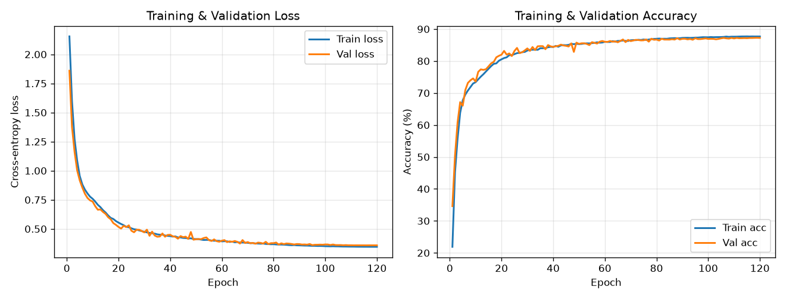
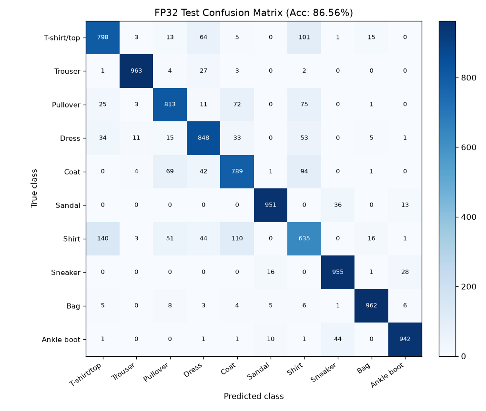

# FP32 Training and Evaluation Report (Milestone 3)

Generated by `python -m sw.train.evaluate`. Do not edit by hand.

## 1. Summary Metrics

| Split | Samples | Cross-Entropy Loss | Accuracy (%) | Correct / Total |
|---|---|---|---|---|
| **train** | 54,000 | 0.3458 | **87.69%** | 47,350 / 54,000 |
| **val** | 6,000 | 0.3588 | **87.27%** | 5,236 / 6,000 |
| **test** | 10,000 | 0.3854 | **86.56%** | 8,656 / 10,000 |
| **hardware test vectors** | 100 | – | **85.0%** | 85 / 100 |

## 2. Training Configuration

| Setting | Value |
|---|---|
| Checkpoint | `fp32_best.pt` (epoch 119) |
| Epochs | 120 |
| Batch size | 128 |
| Optimizer | AdamW (max_lr=0.01, weight_decay=0.0) |
| LR Scheduler | OneCycleLR (15% warmup + cosine anneal) |
| Weight Init | Kaiming Normal |
| Seed | 42 |
| Input tensor | `1 × 32 × 32` (`28×28` + 2-px zero border, `x = (pixel >> 1) / 128`) |
| Total parameters | 1,418 (1,384 weights + 34 biases) |
| Model size | 5,672 B (FP32) / 1,520 B (INT8 weights + INT32 biases) |
| Total MACs / image | 259,648 |

## 3. Inference Tensor Dimensions (Single Image, `N = 1`)

| Stage | Shape `(C, H, W)` | Elements |
|---|---|---|
| `input` | `(1, 32, 32)` | 1,024 |
| `conv1` | `(8, 30, 30)` | 7,200 |
| `relu1` | `(8, 30, 30)` | 7,200 |
| `pool1` | `(8, 15, 15)` | 1,800 |
| `conv2` | `(16, 13, 13)` | 2,704 |
| `relu2` | `(16, 13, 13)` | 2,704 |
| `gap` | `(16,)` | 16 |
| `fc` | `(10,)` | 10 |

## 4. Per-Class Test Accuracy (Official 10,000-Image Test Split)

| Class ID | Class Name | Correct / Support | Test Accuracy (%) | Precision (%) |
|---|---|---|---|---|
| 0 | T-shirt/top | 798 / 1000 | 79.80% | 79.48% |
| 1 | Trouser | 963 / 1000 | 96.30% | 97.57% |
| 2 | Pullover | 813 / 1000 | 81.30% | 83.56% |
| 3 | Dress | 848 / 1000 | 84.80% | 81.54% |
| 4 | Coat | 789 / 1000 | 78.90% | 77.58% |
| 5 | Sandal | 951 / 1000 | 95.10% | 96.74% |
| 6 | Shirt | 635 / 1000 | 63.50% | 65.67% |
| 7 | Sneaker | 955 / 1000 | 95.50% | 92.09% |
| 8 | Bag | 962 / 1000 | 96.20% | 96.10% |
| 9 | Ankle boot | 942 / 1000 | 94.20% | 95.06% |

## 5. Test Confusion Matrix (Rows = True, Columns = Predicted)

| True \ Pred | **0** | **1** | **2** | **3** | **4** | **5** | **6** | **7** | **8** | **9** |
|---|---|---|---|---|---|---|---|---|---|---|
| **0 (T-shirt/top)** | **798** | 3 | 13 | 64 | 5 | 0 | 101 | 1 | 15 | 0 |
| **1 (Trouser)** | 1 | **963** | 4 | 27 | 3 | 0 | 2 | 0 | 0 | 0 |
| **2 (Pullover)** | 25 | 3 | **813** | 11 | 72 | 0 | 75 | 0 | 1 | 0 |
| **3 (Dress)** | 34 | 11 | 15 | **848** | 33 | 0 | 53 | 0 | 5 | 1 |
| **4 (Coat)** | 0 | 4 | 69 | 42 | **789** | 1 | 94 | 0 | 1 | 0 |
| **5 (Sandal)** | 0 | 0 | 0 | 0 | 0 | **951** | 0 | 36 | 0 | 13 |
| **6 (Shirt)** | 140 | 3 | 51 | 44 | 110 | 0 | **635** | 0 | 16 | 1 |
| **7 (Sneaker)** | 0 | 0 | 0 | 0 | 0 | 16 | 0 | **955** | 1 | 28 |
| **8 (Bag)** | 5 | 0 | 8 | 3 | 4 | 5 | 6 | 1 | **962** | 6 |
| **9 (Ankle boot)** | 1 | 0 | 0 | 1 | 1 | 10 | 1 | 44 | 0 | **942** |

## 6. Figures

